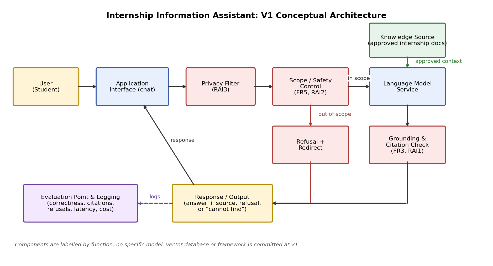
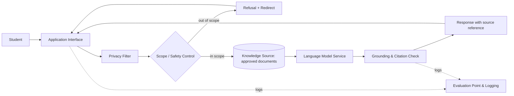

# Architecture Decisions & Traceability — Internship Information Assistant



## Step C1 — Simplest architecture

`User Query → AI Application → AI Capability → Response`

Check against requirements: a bare language model could produce fluent answers (FR6, NFR1) but cannot meet grounding, citation, refusal or privacy needs (FR1–FR5, RAI1–RAI3). Additional components are therefore needed.

## Step C2 — Architecture needs from requirements

| Requirement ID | What does the requirement need? | Architecture Response |
|---|---|---|
| FR1, FR2, NFR2 | Answers must come from approved internship documents and be correct. | Knowledge source access (approved documents) |
| FR3, FR4, RAI1 | Verifiable source references and "insufficient evidence" behaviour. | Source tracking and a response check/grounding step |
| FR5, RAI2 | Out-of-scope queries must be refused and redirected. | Scope / safety control |
| RAI3 | No student PII sent to external model APIs. | Privacy filter before the language model service |
| NFR1, NFR3 | Latency and cost targets must be met. | Efficient interaction path; usage and latency logging |
| NFR4 | Document updates without rebuilding other parts. | Knowledge source managed separately from the application |
| NFR2, RAI1–RAI2, RAI4 | Evidence that thresholds are met. | Evaluation point(s) with logging |

## Step C3 — V1 conceptual components (labelled by function, not technology)

1. **User (Student)**
2. **Application Interface** (chat)
3. **Privacy Filter** (PII detection/redaction)
4. **Scope / Safety Control** (in/out of scope; refusal + redirect)
5. **Knowledge Source** (approved internship documents)
6. **Language Model Service**
7. **Grounding & Citation Check**
8. **Response / Output** (answer + source reference, or refusal / "cannot find")
9. **Evaluation Point & Logging** (latency, cost, correctness, citations, refusals)



## Step C4 — Architecture Decision Records

| Decision | Requirement / Constraint | Alternatives Considered | Selected Option | Trade-off Accepted |
|---|---|---|---|---|
| ADR1: Include knowledge access | FR1–FR3, NFR2, RAI1: answers must be grounded in approved documents and cited | Base model only; static keyword/FAQ lookup; dynamic knowledge access | Generic knowledge-access component over approved documents | More system complexity and a document-maintenance burden, but better grounding and traceability |
| ADR2: Include explicit scope control | FR5, RAI2: out-of-scope queries must be refused (≥ 95%) | Prompt instructions only; explicit scope-control component | Explicit scope control before generation | Possible false refusals and extra processing time (affects NFR1), but more reliable refusals |
| ADR3: Include privacy filter before the model | RAI3: zero PII sent to external APIs | No filter (trust users); filter before model call | Privacy filter before the Language Model Service | Added latency and risk of over-redaction reducing answer quality, but protects student data |

## Initial Requirements Traceability Matrix

| Objective | Requirement | Evaluation Criterion | Architecture Element | Later Evidence |
|---|---|---|---|---|
| O1 | FR3, FR4, RAI1 | Source citation and support | Knowledge Source; Grounding & Citation Check | Citation presence/match results on test set |
| O2 | FR5, RAI2 | Out-of-scope refusal | Scope / Safety Control | Refusal-and-redirect results on ≥ 20 queries |
| O3 | FR1, FR2, NFR2 | Answer correctness | Knowledge Source; Language Model Service | Rubric-scored correctness on ≥ 50 questions |
| O3 | NFR1, NFR3 | Latency and cost | Application Interface path; Evaluation Point & Logging | p90 latency and cost-per-100-queries logs |
| O2 | RAI3 | PII transmission count | Privacy Filter | Payload inspection results (0 PII) |

## Final review checklist

- [x] Each major component supports a requirement or evaluation need (see C2 and the matrix).
- [ ] Any missing data source, safety control or evaluation point? Consider whether the document set needs a separate ingestion/update step (NFR4), to be refined in Topic 3.
- [x] No specific model, vector database or framework has been committed to.
- [ ] Simpler alternative? If the document set is tiny, the grounding check could be merged into the language model step; revisit after baseline results.

## Reflection

**Which architecture decision involved the most important trade-off?**

Draft answer (edit to your own view): ADR2 (scope control). It is driven by RAI2 (≥ 95% refusal of out-of-scope queries); the accepted trade-off is some false refusals of legitimate questions plus extra processing time, which puts pressure on NFR1 (latency) and the usefulness of the assistant.

## Git

```bash
git add docs/week2_architecture_v1.png docs/week2_architecture_decisions.md
git commit -m "Week 2: Add V1 architecture, ADR, and traceability"
git push
```
